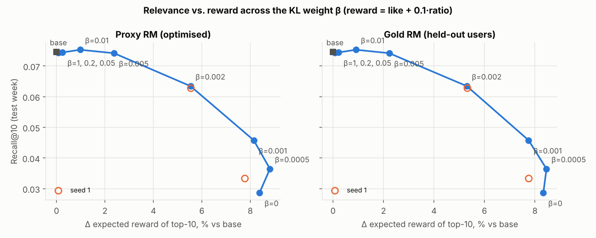
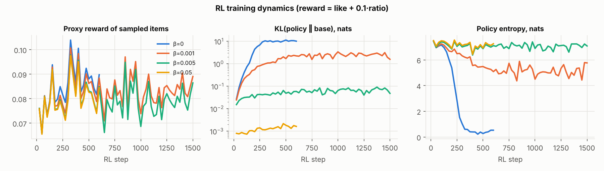
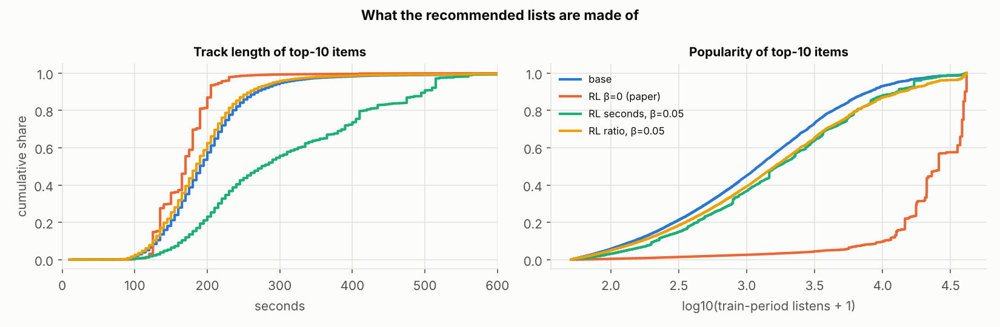
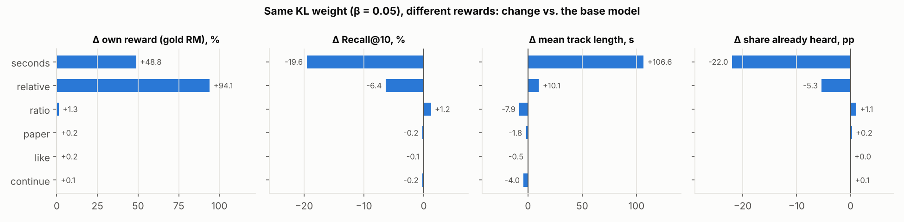
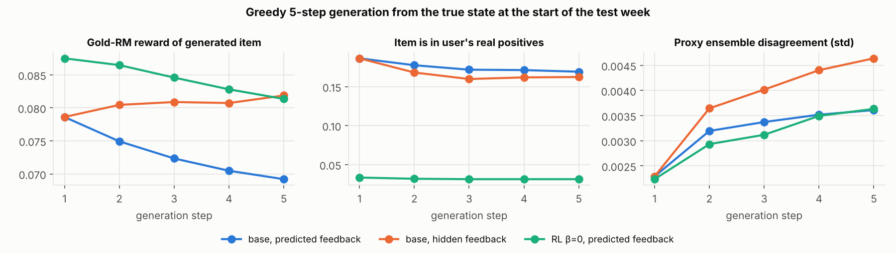

# RL fine-tuning of a GPT-2 sequential recommender on Yambda-50M

A next-item GPT-2 recommender is trained on Yambda-50M music listening logs. A reward model is fitted
to predict user feedback, and the recommender is then fine-tuned with policy-gradient RL against
that reward model. The goal is to measure what changes, what breaks and why, all under one
leakage-free temporal evaluation protocol.

**Main findings**

1. **Unregularised RL (β = 0) "wins" its reward and loses relevance.** Expected reward of the top-10
   rises by +8.4% (proxy RM) and +8.3% (held-out gold RM). At the same time Recall@10 falls by 62%:
   the policy collapses to about five globally popular, short tracks. Top-10 lists of two random
   users overlap by 41% (base: 0.1%), and catalogue coverage drops from 21.7% to 2.6%.
2. **The KL weight traces a concave relevance–reward front, and its useful part is narrow.**
   - β = 0.005: +2.4% reward at −0.6% Recall@10, practically free.
   - β = 0.002: +5.5% reward for −15% Recall@10.
   - β ≤ 0.001: the policy slides into the collapse.
   - β ≥ 0.01: the policy barely moves.

   A second seed reproduces the β = 0.002 point to within 1 pp.
3. **Each reward definition has a predictable failure mode.**
   - *Listened seconds* pushes track length from 204 s to 310 s (−20% Recall@10).
   - *Listened ratio* favours popular and slightly shorter tracks.
   - *Ratio relative to the track's own average* lowers the share of already-heard tracks.
   - *Likes* and *session continuation* barely move the policy, because their reward-model heads are
     too sparse or too weak.
4. **Proxy and gold reward rise together, so the RM's errors are not what gets exploited.** The
   collapse is a misspecified objective: both reward models agree that popular, short tracks are
   listened to more fully. They are right about that, and it is still a bad recommender.
5. **The ensemble-uncertainty penalty does nothing here.** The collapse moves the policy to where
   the reward models agree *most*: ensemble std falls from 0.0137 to 0.0115 on the collapsed lists.
   A pessimistic bonus cannot stop a failure that happens in the RMs' most confident region.
6. **Multi-step generation drifts.** With the feedback the RM predicts for its own items, the
   predicted reward falls at every step. With hidden feedback it rises while ensemble disagreement
   doubles, a sign that the RM is scoring inputs it never saw in training.

---

## 1. Data and protocol

**Dataset:** Yambda-50M, flat `multi_event` table [3]. It has 47.8M events from 10k users, of which
46.5M are listens with `played_ratio_pct`, `track_length_seconds` and an `is_organic` flag. The
data spans about 4 years.

**Split:** a global temporal split. The last 7 days are the test set (333k listens, 5.5k users). The
7 days before that are validation. Everything earlier is train. Every prediction uses only events
strictly before its target.

**Vocabulary:** the top 100,000 tracks by train-period listens, plus `PAD` and `OOV`. They cover 85%
of test listens. Out-of-vocabulary targets count as misses in every metric.

**Token = one listen.** Its embedding is the sum of five parts:
- item
- listened-ratio bucket (11 bins + "hidden")
- reaction (none / like / dislike / hidden)
- organic flag
- duration bucket (7 bins)

**Reactions.** In Yambda, likes are separate events. Only about 30% of them occur within ±10 minutes
of a listen of the same track; the rest are library actions. We therefore attach a like to the
nearest listen of that track within 10 minutes. A like logged after the listen is kept only if it
happened no later than the user's next listen, so it can never leak into a later context.
`tests/test_data.py` covers these rules. As a result, 0.57% of listens carry a like.

**Metrics.** Two protocols are shared by every model:
- *Next item, teacher-forced:* Hit@K, NDCG@K and MRR over every test listen, sliced into
  non-organic, positive (played ≥ 50% or liked) and in-vocabulary listens.
- *User level:* one ranked list per user from the state at the start of the test week, scored
  against the user's positively-played tracks of that week with Recall@K, NDCG@K and MAP@K.

**Behaviour statistics** of the top-10 lists:
- mean popularity and track length;
- catalogue coverage;
- share of slots taken by the 10 most-recommended items;
- Jaccard overlap between random user pairs;
- share of already-heard tracks;
- distinct artists per list.

## 2. Stage 1 — base model

GPT-2 (Hugging Face `GPT2Model`): 4 layers, d = 256, 4 heads, context of 512 events, 28.9M
parameters. The output layer is tied to the item embeddings, and the loss is full-softmax
cross-entropy over the 100k items, computed in checkpointed chunks. Training uses AdamW with a
cosine schedule for 10 epochs (about 1 hour on one A100). Feedback is hidden on 10% of tokens during
training so that the model can act on generated items, where feedback is unknown. The checkpoint
is selected on validation NDCG@10, and the test week is scored once.

| Test week | Hit@10 | NDCG@10 | MRR | Recall@10 (user) | NDCG@10 (user) | MAP@10 (user) | Recall@100 (user) |
|---|---|---|---|---|---|---|---|
| MostPop | 0.005 | 0.003 | 0.003 | 0.008 | 0.021 | 0.009 | 0.038 |
| GPT-2 (run 1 / run 2) | 0.201 / 0.201 | 0.148 / 0.158 | 0.137 / 0.151 | 0.075 / 0.075 | 0.145 / 0.144 | 0.086 / 0.086 | 0.233 / 0.232 |

Recommendation-driven (non-organic) listens are much harder to predict than organic ones: Hit@10 is
0.045 on them. 82% of the base model's top-10 slots are tracks the user has already heard; music is
a repeat-heavy domain.

## 3. Stage 2 — reward model

The reward model reuses the GPT-2 backbone, initialised from stage 1. The history state `h`, the
candidate track embedding `c` and its duration bucket feed an MLP on `[h, c, h·c]` with three heads:
- **P(like)**;
- **expected listened ratio** (BCE on the soft target);
- **P(session continues)**: the next listen starts within 30 minutes.

Training-period labels for the last head never look past the validation boundary. The loss weights
are 0.2 / 0.6 / 0.2.

Users are split into two fixed halves. **Three seeds trained on half A form the proxy ensemble** that
RL optimises. **One model trained on half B is the "gold" judge.** It never sees RL and is used to
detect reward hacking, following the proxy-vs-gold design of [5].

| Test week, other-half users | Proxy (A, 3 seeds) | Gold (B) | Naive |
|---|---|---|---|
| Ratio MAE | 0.224 | 0.211 | 0.39–0.41 (predict mean) |
| Ratio correlation | 0.69 | 0.70 | — |
| Skip (< 50%) ROC-AUC | 0.884 | 0.890 | 0.5 |
| Like ROC-AUC / PR-AUC | 0.86 / 0.06 | 0.84 / 0.10 | 0.5 / 0.006 |
| Continue ROC-AUC | 0.65 | 0.60 | 0.5 |

The ratio head is well calibrated: in every decile of the prediction, the predicted and actual mean
ratio differ by at most 0.04. The like head is far better than chance but works on a very rare
signal. The continuation head is weak. Note also that the three proxy seeds agree to the third
decimal, so the ensemble is not very diverse (see §6).

## 4. Stage 3 — RL fine-tuning

**State.** A real train-period context of 256 events that ends right before a recommendation-driven
(non-organic) event, i.e. a moment where the recommender was in control. There are 21M such states.

**Action.** The next track, sampled from the policy over the vocabulary. With horizon T = 5 the
policy rolls out five tracks. Each generated track is appended with either the feedback the RM
predicts for it or hidden feedback.

**Objective.** Policy gradient with a leave-one-out group baseline (RLOO [6]): for each state, G = 8
continuations are sampled and each one's return is compared with the mean of the other seven. The
loss adds β · KL(π ‖ π_base). This KL is exact: it is computed over the full 100k-item vocabulary at
every generated position, not estimated from samples. Other settings: 32 states per step, 600 steps
(about 2 minutes on an A100) or 1,500 steps for the fine β sweep, AdamW with lr 1e-5, no dropout,
γ = 0.9.

**Rewards** are computed from the proxy ensemble (mean minus λ·std):

| Name | Definition | Hypothesis |
|---|---|---|
| `paper` | P(like) + 0.1·ratio, as in [1] | reference |
| `ratio` | expected listened share | favours short tracks |
| `seconds` | ratio × track length / 300 s | favours long tracks |
| `like` | P(like) | favours familiar or popular tracks |
| `relative` | ratio − the track's mean train ratio | removes the "safe track" bias |
| `continue` | P(session continues within 30 min) | proxy for a long-term goal |

**Evaluation** after RL uses the protocol of §1 together with:
- the expected reward of each user's top-10 under the proxy ensemble and under the gold RM;
- the real feedback on recommended tracks that users actually played;
- greedy five-step generation from the true test-week state.

## 5. Results

The full table, regenerated by `scripts/analyze.py`, is in `results/summary.md`. All numbers below
are on the test week, user-level, top-10.

### 5.1 What RL changes (Q1, Q2)

| β (steps) | Recall@10 | NDCG@10 | Δ reward, proxy / gold | Track length | Popularity | Coverage | Jaccard | Already heard | KL, nats |
|---|---|---|---|---|---|---|---|---|---|
| Base | 0.0746 | 0.144 | — | 204 s | 3.2k | 21.7% | 0.001 | 82% | 0 |
| 0.2 (600) | 0.0744 | 0.144 | +0.1% / +0.1% | 203 s | 3.3k | 21.6% | 0.001 | 82% | 0.0004 |
| 0.05 (600) | 0.0744 | 0.144 | +0.3% / +0.2% | 202 s | 3.4k | 21.4% | 0.001 | 82% | 0.002 |
| 0.01 (600) | 0.0753 | 0.144 | +1.0% / +0.9% | 197 s | 4.2k | 20.5% | 0.002 | 83% | 0.017 |
| 0.005 (1500) | 0.0742 | 0.143 | +2.4% / +2.2% | 189 s | 5.7k | 18.3% | 0.004 | 83% | 0.05 |
| 0.002 (1500) | 0.0634 | 0.124 | +5.5% / +5.3% | 178 s | 11.0k | 13.7% | 0.034 | 79% | 0.40 |
| 0.002 (1500, seed 1) | 0.0628 | 0.123 | +5.5% / +5.3% | 178 s | 11.5k | 13.8% | 0.038 | 80% | 0.55 |
| 0.001 (1500) | 0.0458 | 0.092 | +8.1% / +7.7% | 169 s | 14.9k | 9.8% | 0.106 | 68% | 1.6 |
| 0.0005 (1500) | 0.0365 | 0.076 | +8.8% / +8.5% | 165 s | 18.5k | 7.1% | 0.191 | 63% | 2.8 |
| **0 (600)** | **0.0286** | **0.049** | **+8.4% / +8.3%** | **169 s** | **26.4k** | **2.6%** | **0.41** | **55%** | **10.2** |
| 0 (1500, seed 1) | 0.0333 | 0.055 | +7.8% / +7.8% | 170 s | 25.1k | 3.2% | 0.32 | 58% | 10.0 |





Without the KL term, entropy falls from 7.5 to 0.5 nats within 300 steps (a second seed with 1,500
steps ends the same way). By the end, a batch of
256 samples contains only 5 distinct tracks, and the KL to the base model reaches 10 nats. The policy
has found a few tracks that the reward model rates highly *for almost everyone*: popular tracks
(mean popularity ×8) and short tracks (−35 s). This is a direct consequence of the objective. With
`paper`, the 0.1·ratio term dominates in magnitude (mean 0.07 vs 0.007 for likes). A track that is
rarely skipped and short is listened to further, whoever the user is. So the policy stops
personalising: 41% of any two users' top-10 coincide.

The tracks it chose are not bad tracks. Among recommended tracks that users actually played in the
test week, the mean listened ratio is 0.90 under β = 0 against 0.83 for the base model. But users
played far fewer of them: 2,961 against 7,527 played recommendations. (This ratio is computed on
hits only, so it is biased towards tracks a user would have chosen anyway.) The pattern is monotone
along the front: as β decreases, the listened ratio of played hits rises (0.836 → 0.853 → 0.883 →
0.896) while the number of hits falls (7,452 → 6,439 → 4,855 → 4,019). Higher reward with lower
relevance is the main result, and the task statement anticipates it.

The front is not even reward-optimal at β = 0. β = 0.0005 reaches a *higher* test-time reward
(+8.8%) than β = 0 (+8.4%) with 28% more recall. Full collapse overfits to the training states,
and a little KL regularisation helps the reward itself generalise.



### 5.2 Reward definitions (Q1, Q3)



At the same β = 0.05:

- **`seconds`** produces the predicted bias almost in isolation. Track length rises by 107 s, and
  the share of familiar tracks falls by 22 pp, because long tracks are rarer in a user's history.
  Recall@10 drops by 20%. Rewarding listened *time* rewards long tracks, not better ones.
- **`ratio`** shifts towards popular, slightly shorter tracks (popularity ×1.5, −8 s). Recall is
  unchanged.
- **`relative`** subtracts each track's own average ratio, which removes the "safe track" shortcut.
  Its reward rises the most (+94%), and the share of familiar tracks falls by 5 pp, but Recall falls
  by 6%. It rewards *surprisingly* well-received tracks, which our relevance metric (did the user
  play it this week) does not credit.
- At smaller β (1,500 steps, seed 1), `seconds` collapses completely. Already at β = 0.002 every
  sampled action is the same track (entropy 0). The top-10 lists average 345 s per track, Recall@10
  falls by 75% and reward rises by 52%. `ratio` at β = 0 collapses to two tracks.
- **`like`** and **`continue`** leave the policy almost unchanged (|Δ| < 0.3%). For `like`, the head
  averages 0.007 and its gradient is tiny next to the KL. For `continue`, the head has ROC-AUC 0.60–0.65
  and predicts about 0.88 for nearly every track, so there is little signal to climb.

**Towards long-term goals.** `continue` is our attempt at a retention-style reward: P(the user keeps
listening in the next 30 minutes). Offline it is weakly predictable. More importantly, an offline
replay cannot test the effect we actually care about, which is whether the user's *future* behaviour
changes. The logs contain no propensities, so off-policy estimators like IPS are not available here
(contrast [1], which estimates behaviour-policy probabilities). The signals that could support such
a reward are:
- session length;
- return within N hours or days;
- the number of organic searches after a recommendation;
- like/dislike rate per session.

Validating any of them requires an online A/B test with retention metrics. Offline, we can only
check (a) relevance on held-out logs, (b) agreement between independent reward models and (c) that
the policy's distributional shift stays bounded (KL, coverage, repeat share).

### 5.3 Several steps ahead (Q4)



Generation runs greedily for five steps from the true state at the start of the test week. Each
generated track is appended to the context, either with RM-predicted feedback or with hidden
feedback.

- **Relevance decays.** The share of generated tracks that the user really played positively that
  week drops from 0.186 at step 1 to 0.169–0.162 at step 5. Every step conditions on an
  interaction that never happened.
- **The reward depends on how the fake feedback is written.** With *predicted* feedback, the
  appended ratio is an expectation (~0.7). That looks like a partial listen, while real histories
  are dominated by full listens (median ratio = 100%). The context drifts towards "skippy" sessions,
  and the RM predicts less listening at every step (0.079 → 0.069). With *hidden* feedback the
  reward rises slightly, but proxy-ensemble disagreement doubles (0.0023 → 0.0046): the RMs were
  trained without hidden-feedback tokens, so this context is out of distribution for them.
- **Training on T = 5 rollouts** (β = 0.05, run twice) behaves like T = 1 at the same β. The two
  runs agree to the third decimal, which also shows that run-to-run variance is small.

The predicted return of a multi-step plan is only as good as the RM's behaviour on synthetic
contexts, and that behaviour moves in opposite directions depending on how the synthetic feedback is
encoded. Model-based multi-step evaluation, as in [1], needs feedback that matches real feedback in
distribution: sample it from the predicted distribution rather than append its mean.

### 5.4 The relevance–reward trade-off (Q5)

The β sweep (figure in §5.1) traces a concave front with three regimes:

| Regime | β | KL to base | Reward | Recall@10 |
|---|---|---|---|---|
| Anchored | ≥ 0.01 | < 0.02 nats | ≤ +1% | unchanged |
| Useful | 0.002–0.005 | 0.05–0.55 nats | +2.4% to +5.5% | −0.6% to −15% |
| Collapse | ≤ 0.001 | > 1.5 nats | +8% (saturates) | −39% to −62% |

The front is reproducible: the second seed at β = 0.002 lands within 1 pp on every metric. So yes,
the reward can be raised without a noticeable loss of accuracy, but only by about 2%. Every further
percent costs a growing share of relevance, and past roughly 8% the reward stops growing while
relevance keeps falling.

The reward definition moves the front far more than β does:
- at β = 0.05, `ratio` costs nothing while `seconds` already costs 20% of Recall@10;
- at β = 0.002, `paper` keeps 85% of recall, while `ratio` keeps 44% and `seconds` keeps 25%.

A reward whose maximiser is a *constant* list (a long track for everyone, a safe track for
everyone) needs a much stronger anchor than one whose maximiser depends on the user.

### 5.5 Is this reward hacking?

Proxy and gold reward rise together in every run (+8.4% / +8.3% at β = 0). By the proxy-vs-gold
criterion [5], the policy is **not** exploiting errors specific to the reward models it optimised.
It is optimising a reward that both models agree on. The failure lies in the reward *specification*:
"expected listening of the next track" does not capture "relevant to this user". A KL anchor to the
behaviour-cloned model is what keeps personalisation alive.

Caveat: the gold RM shares the stage-1 initialisation and architecture with the proxy ensemble, so
its errors are correlated with theirs. It is held out in users, not in inductive bias.

**The pessimistic penalty** (reward = mean − λ·std over the three proxy RMs, λ = 1) has no
measurable effect:
- at β = 0 it still collapses (Recall@10 0.0276, +8.6% reward);
- at β = 0.05 it matches the unpenalised run.

There are two reasons:
1. The three proxy seeds are nearly identical, so the std is small.
2. The collapse heads *towards* agreement: on the collapsed lists the ensemble std falls from
   0.0137 to 0.0115, because popular tracks are where the RMs have the most data.

Uncertainty penalties protect against extrapolation. They do not protect against a confidently
misspecified objective.

## 6. Limitations

- **Offline only.** Every reward is a model prediction; the one real-feedback check (§5.1) is
  biased towards hits.
- **No propensities in Yambda**, so no IPS or doubly-robust off-policy estimate.
- **Gold RM not fully independent** (shared initialisation, same architecture). The three proxy seeds
  are nearly identical, so the ensemble-std penalty has little to work with.
- **Vocabulary capped at 100k tracks** (85% coverage); cold tracks can never be recommended.
- **Two seeds only for β ∈ {0, 0.002}** (plus the duplicated T = 5 run). Where measured, seed
  noise is ≤ 1 pp, far smaller than the effects reported. The fine sweep (1,500 steps) and the coarse
  sweep (600 steps) differ in training length.
- **Likes are sparse after attribution** (0.57% of listens), so the like head and the `like` reward
  are weak.

## 7. Next steps

- Adaptive KL control: target a KL budget instead of fixing β, since the useful region is narrow.
- Make the gold judge independent: different initialisation, or a non-neural model such as gradient
  boosting on hand-built features.
- Make the ensemble diverse (bootstrap users, different heads) so that the pessimistic penalty
  becomes meaningful.
- For multi-step: sample feedback instead of appending its mean, and train the RM with hidden-feedback
  dropout.
- Combine rewards with an explicit diversity or coverage constraint instead of relying on KL alone.
- Online: A/B test with session length and day-7 return as long-term metrics.

## 8. Reproduce

```bash
pip install -r requirements.txt
python scripts/upload_yambda.py --no-upload            # downloads data/yambda-50m
python -m pytest -q tests                              # 25 tests: leakage, metrics, KL, RL sign

python scripts/train_base.py   --data-dir data/yambda-50m
python scripts/train_reward.py --data-dir data/yambda-50m --base-checkpoint outputs/base/model.pt
python scripts/train_rl.py     --data-dir data/yambda-50m --base-checkpoint outputs/base/model.pt \
    --rm-dir outputs/reward --rewards paper --betas 0,0.01,0.05,0.2,1 --eval-base
python scripts/analyze.py --corpus-cache data/cache/v100000_val7_test7
```

Every script also runs on a ClearML agent with `--clearml --queue <queue>`. The ClearML project and
dataset ids come from environment variables (`scripts/env.example.ps1`). `results/` holds the metrics
and logs of every run reported here; checkpoints are not committed.

## References

1. A. Matveev, S. Makeev, A. Krasilnikov, V. Baikalov, S. Liamaev, K. Khrylchenko. *Session-Level
   Optimization for Large-Scale Retrieval using REINFORCE with Multi-Step Off-Policy Correction.*
   KDD 2026 workshop. arXiv:2607.02818.
2. A. V. Petrov, C. Macdonald. *Aligning GPTRec with Beyond-Accuracy Goals with Reinforcement
   Learning.* arXiv:2403.04875, 2024.
3. A. Ploshkin et al. *Yambda-5B — A Large-Scale Multi-modal Dataset for Ranking and Retrieval.*
   arXiv:2505.22238, 2025.
4. M. Chen et al. *Top-K Off-Policy Correction for a REINFORCE Recommender System.*
   arXiv:1812.02353, 2018.
5. L. Gao, J. Schulman, J. Hilton. *Scaling Laws for Reward Model Overoptimization.* ICML 2023,
   arXiv:2210.10760.
6. A. Ahmadian et al. *Back to Basics: Revisiting REINFORCE Style Optimization for Learning from Human
   Feedback in LLMs.* arXiv:2402.14740, 2024.
7. A. Radford et al. *Language Models are Unsupervised Multitask Learners* (GPT-2). OpenAI, 2019.
